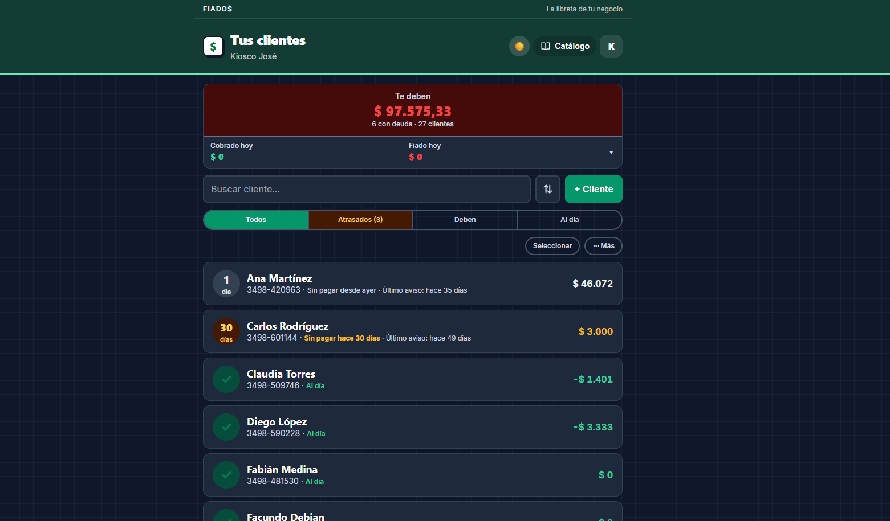
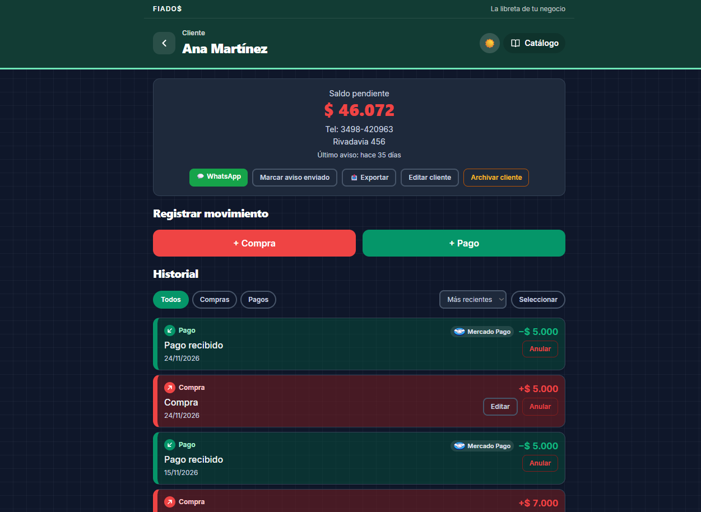
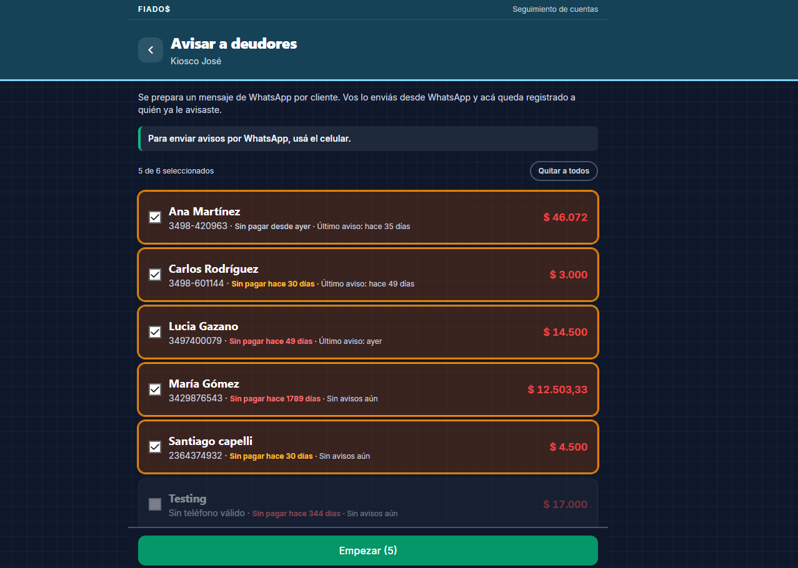

# FIADO$ — cuenta corriente para comercios

FIADO$ es una aplicación web para gestionar el fiado de pequeños comercios.
Permite registrar lo que compra y paga cada cliente, consultar su saldo y hacer
seguimiento de las cuentas pendientes desde el celular o la computadora.

## Capturas

Lista de clientes con saldos, filtros y resumen del negocio.



<details>
<summary>Ver ficha del cliente y avisos por WhatsApp</summary>

### Ficha del cliente

Saldo pendiente, registro de compras y pagos e historial de movimientos.



### Avisos por WhatsApp

Selección de clientes con deuda para preparar los recordatorios.



</details>

## El problema

En un comercio, llevar el fiado en una libreta exige revisar compras y pagos para
saber cuánto debe cada cliente. FIADO$ reúne esos movimientos en una ficha y
calcula el saldo a partir del historial vigente.

## Funciones principales

- **Clientes:** alta, búsqueda, edición y archivo de fichas.
- **Compras y pagos:** compra rápida por monto o con productos, pagos parciales y registro del medio de pago.
- **Historial:** consulta de movimientos, anulación y restauración con actualización del saldo.
- **Cobranza:** días sin pagar, mensajes editables para WhatsApp y registro de avisos confirmados.
- **Excel:** importación de clientes y productos; exportación de listas y fichas excluyendo movimientos anulados.
- **Uso diario:** interfaz adaptable a celular, tema claro y oscuro y sincronización entre pestañas.

## Stack

React · Vite · Tailwind CSS · Node.js · Express · PostgreSQL · ExcelJS.

El frontend consume una API REST. El backend utiliza JWT para autenticar las
sesiones y vincula los datos a cada negocio. PostgreSQL calcula los saldos a
partir de compras y pagos activos. Las pruebas de integración verifican también
que un negocio no pueda acceder a los datos de otro.

Las decisiones de diseño y el modelo de datos están en
[`DOCUMENTACION_TECNICA.md`](./DOCUMENTACION_TECNICA.md).

## Requisitos previos

Para publicar una demo gratuita con datos ficticios y un enlace para el CV, ver
[`docs/PUBLICAR.md`](./docs/PUBLICAR.md). El repositorio incluye la configuración
de Render y conexión a PostgreSQL mediante `DATABASE_URL` para Neon.

- Node.js 22.12+ (probado con Node 24) y npm
- PostgreSQL instalado localmente (o acceso a una instancia)

## Puesta en marcha

### 1. Base de datos

Crear la base `kiosco_db` en PostgreSQL y ejecutar `schema.sql` sobre ella
(ver `DOCUMENTACION_TECNICA.md`, sección 4.3, para el modelo de datos completo).

Desde la raíz del clon, con las herramientas de PostgreSQL en el PATH:

```bash
createdb -U postgres kiosco_db
psql -U postgres -d kiosco_db -v ON_ERROR_STOP=1 -f schema.sql
```

`schema.sql` se ejecuta una sola vez sobre una base vacía. No lo ejecutes sobre
una base con datos. Con pgAdmin podés crear la base y ejecutar el mismo archivo.

Instalá las versiones de los dos lockfiles, sin depender de un `node_modules` anterior:

```bash
npm run setup
```

En PowerShell con ejecución de scripts deshabilitada, usá `npm.cmd` en lugar de `npm`.

### 2. Backend

```bash
cd backend
```

Copiar `backend/.env.example` a `backend/.env` y completar las credenciales locales.
El archivo `.env` no se versiona. Ejemplo de las variables:
```
PORT=3000
DB_HOST=localhost
DB_PORT=5432
DB_USER=postgres
DB_PASSWORD=tu_contraseña
DB_NAME=kiosco_db
JWT_SECRET=un_texto_largo_y_aleatorio
```

```bash
npm run dev
```

### 3. Frontend

En otra terminal, desde la raíz del repositorio:

```bash
cd frontend
npm run dev
```

Si agregás una dependencia nueva, reiniciá `npm run dev`.

Abrir `http://localhost:5173`.

El frontend conecta `/api` con el backend en `http://localhost:3000` durante el
desarrollo. Si cambiás ese puerto, actualizá el proxy en `frontend/vite.config.js`.

### 4. Crear el primer negocio

En otra terminal, desde la raíz del repositorio:

```bash
cd backend
node src/crear-negocio.js "Nombre del negocio" usuario contraseña telefono rubro direccion
```

## Pruebas y verificación

Desde la raíz, con PostgreSQL disponible y `backend/.env` configurado:

```bash
npm run verify
```

Ejecuta las pruebas de frontend y cuenta corriente, el lint de ambos proyectos y
el build. También se pueden ejecutar `npm test`, `npm run lint` y `npm run build`.
El build queda en `frontend/dist`; no publica nada.

La prueba `backend/test/cuenta-corriente-aislada.test.js` crea un esquema temporal único
en la base configurada, carga allí el schema y lo elimina al terminar. Requiere
permiso para crear esquemas. Verifica alta, compra de $5.000, pago de $2.000,
saldo de $3.000, anulaciones/restauraciones y aislamiento entre negocios.
No altera los datos existentes. Las regresiones de frontend verifican WhatsApp
y los archivos Excel serializados (incluida la exclusión de anulados en todas las hojas).

### Prueba manual en vista móvil

Usá un negocio de pruebas creado con el script anterior. En las herramientas del
navegador activá una vista de 390 × 844 y probá:

1. Crear `Cliente ficticio portfolio`, sin teléfono, con nota `Prueba de interfaz`.
2. Abrir su ficha, elegir compra rápida y registrar $5.000.
3. Registrar un pago parcial de $2.000 en efectivo. El saldo debe quedar en $3.000.
4. Volver a la lista y recargar: el saldo y ambos movimientos deben conservarse.
5. Comprobar que los formularios y acciones se vean completos, sin desplazamiento horizontal.

La ida y vuelta a WhatsApp requiere además un teléfono real con la app instalada:
la emulación de pantalla no comprueba la apertura de aplicaciones del sistema.
En móvil se usa `whatsapp://` en la misma pestaña para conservar la pantalla de
FIADO$ al volver. En escritorio se intenta reutilizar la ventana abierta desde
FIADO$; el navegador o WhatsApp pueden impedirlo. No se puede controlar una
pestaña de WhatsApp abierta manualmente. `Copiar mensaje` permite usarla sin
abrir más pestañas. El aviso se registra recién cuando confirmás el envío.

## Scripts útiles

| Script | Uso |
|---|---|
| `backend/src/crear-negocio.js` | Alta de un negocio nuevo con su usuario |
| `backend/src/cambiar-clave.js` | Restablecer la contraseña de un usuario existente |
| `backend/src/importar-productos.js` | Precargar un catálogo de ejemplo (`.xlsx`) en un negocio. Usar `--probar` para simular. ExcelJS ya se instala con `npm run setup` |

Los comercios pueden importar sus propios productos y clientes (con saldo inicial) desde la
aplicación, con una plantilla de Excel descargable, y exportar listas y fichas a Excel.

## Prueba del flujo de cuenta corriente

Con una base local de desarrollo inicializada con `schema.sql` y `backend/.env` configurado:

```bash
cd backend
npm test
```

La prueba original `backend/test/cuenta-corriente.test.js` inicia la aplicación en un
puerto temporal. Para probar un backend ya en ejecución, configurá `TEST_API_URL`
con la URL base de esa API (incluyendo `/api`) y usá la misma base de datos.
La prueba crea dos negocios temporales y luego los elimina.
Verifica el saldo después de una compra con decimales, un pago parcial, anulaciones
y restauraciones, además del acceso a los datos desde el otro negocio.

## Estado del proyecto

Primera versión funcional. Incluye gestión de clientes, compras, pagos,
seguimiento de cobranza e intercambio de datos con Excel. Este repositorio
contiene el código y las instrucciones para ejecutarlo localmente.

## Licencia

Proyecto privado. Todos los derechos reservados.
